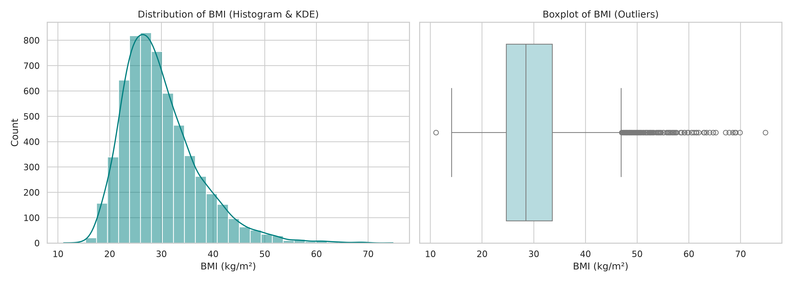
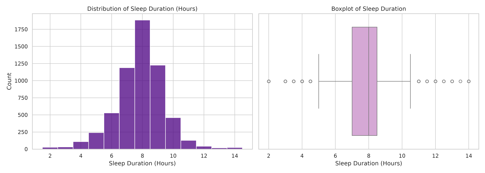

# گزارش فاز اول: آماده‌سازی داده‌ها و آمار توصیفی اولیه

## ۱. روند پاک‌سازی دیتاست
برای شروع، داده‌های خام را از سه فایل دموگرافیک (DEMO)، معاینات فیزیکی (BMX) و خواب (SLQ) خواندیم و بر اساس شناسه مشترک افراد (SEQN) مرج کردیم. 
- تعداد رکوردهای مشترک بعد از ادغام اولیه: ۶۶۱۵ رکورد.
- چون جامعه هدف پروژه بزرگسالان هستند، فیلتر سن بالای ۲۰ سال را اعمال کردیم که تعداد به ۶۰۶۴ نفر کاهش پیدا کرد.
- در نهایت سطرهایی که دیتای گمشده (NaN) در ستون‌های BMI یا ساعت خواب داشتند را دراپ کردیم. 
دیتاست نهایی و تمیز شده شامل **۵۹۱۰** رکورد است.

## ۲. شاخص‌های آماری متغیرها
آمار توصیفی متغیرهای کلیدی پروژه روی دیتاست نهایی به شکل زیر است:

|            متغیر         | تعداد | میانگین | انحراف معیار | میانه | کمینه | بیشینه |
|---------------------------|-------|----------|---------------|-------|--------|--------|
|         سن (سال)          | ۵۹۱۰|   ۵۳.۷۲   |     ۱۷.۱۶    | ۵۷.۰  |  ۲۰.۰  | ۸۰.۰   |
|    شاخص توده بدنی (BMI)  | ۵۹۱۰ |  ۲۹.۸۳   |      ۷.۳۶     | ۲۸.۵  |  ۱۱.۱ |  ۷۴.۸  |
|      مدت خواب (ساعت)     | ۵۹۱۰ |   ۷.۷۰   |      ۱.۵۸     |  ۸.۰  |  ۲.۰   | ۱۴.۰  |

## ۳. بررسی نمودارها و توزیع داده‌ها

**شاخص توده بدنی (BMI)**
همان‌طور که از هیستوگرام مشخص است، توزیع BMI تقارن ندارد و دارای چولگی به راست است. میانگین داده‌ها نزدیک به ۳۰ (مرز چاقی) است. نمودار جعبه‌ای نشان می‌دهد که داده‌های پرت (Outliers) زیادی در سمت راست وجود دارد که نماینده افراد با چاقی شدید (BMI بالای ۴۵ تا ۷۰) در جامعه هستند.

**ساعت خواب شبانه‌روز**
برخلاف BMI، توزیع ساعت خواب تقریباً نرمال و حول و حوش ۷ الی ۸ ساعت متقارن است. باکس‌پلات نشان می‌دهد مقادیر پرت این متغیر محدود به افرادی است که خواب بسیار کم (زیر ۵ ساعت) یا بسیار زیاد (بالای ۱۰.۵ ساعت) گزارش کرده‌اند.

